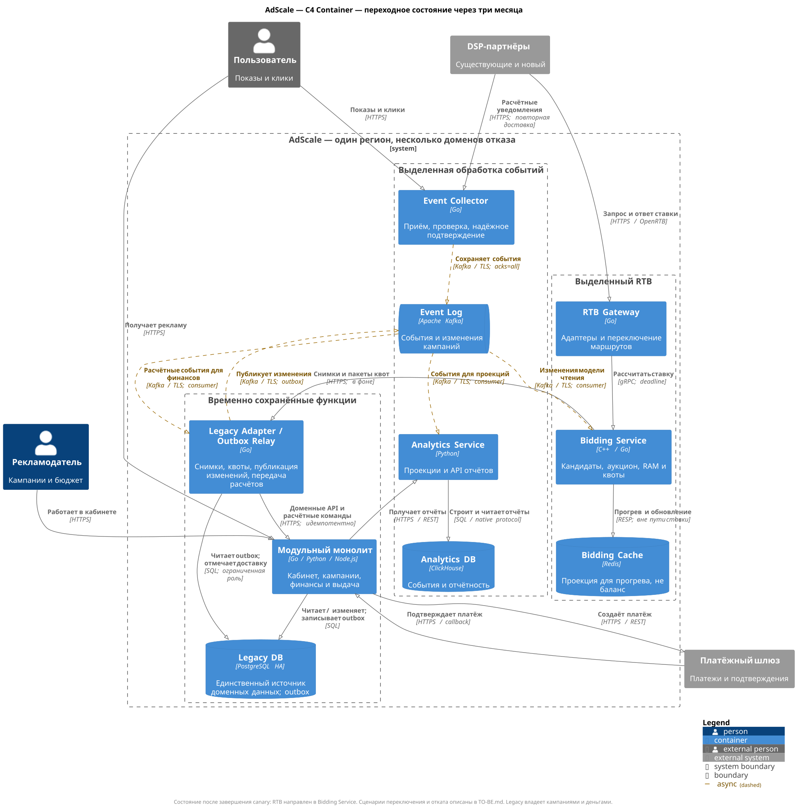
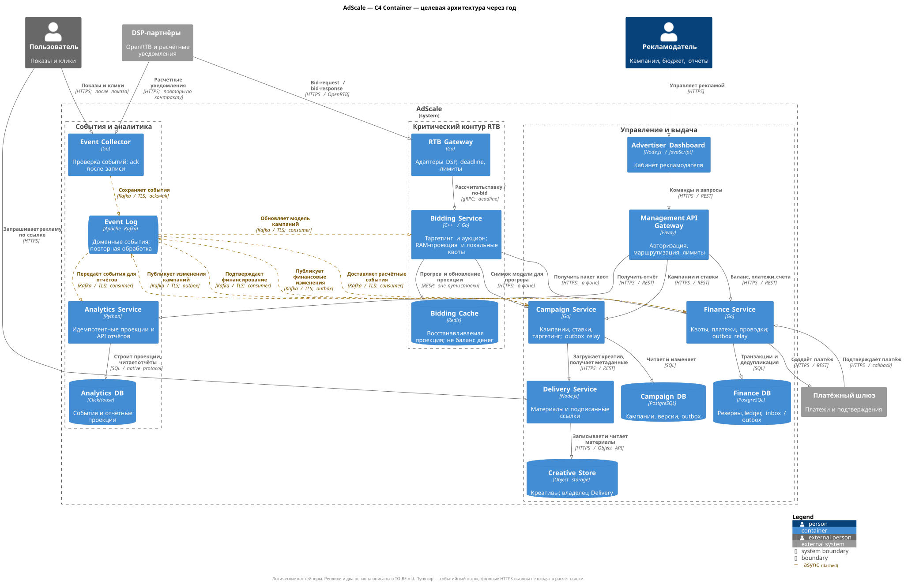

# TO-BE: целевая архитектура и путь перехода

## 1. Архитектурный стиль

Выбран **Strangler Fig с постепенной декомпозицией монолита по доменам**. Маршрутизатор перенаправляет выбранные операции в новые сервисы, пока остальная функциональность продолжает работать в монолите. Внутри оставшейся части вводятся модульные границы. Синхронное взаимодействие сохраняется для короткого запроса ставки и пользовательских команд, события используются для проекций и фоновой обработки. Такое назначение Strangler Fig соответствует [описанию паттерна Microsoft](https://learn.microsoft.com/en-us/azure/architecture/patterns/strangler-fig).

| Вариант | Достоинства | Ограничения для AdScale | Решение |
| --- | --- | --- | --- |
| Сохранить монолит, добавить ресурсы/реплику | Самый быстрый локальный выигрыш, небольшой операционный риск | Сохраняются общая БД, связность релизов и невозможность избирательно масштабировать RTB; годовое целевое состояние не достигается | Использовать только как начальную стабилизацию |
| Модульный монолит как конечная архитектура | Проще эксплуатация и транзакции, полезен небольшой команде | Сам по себе не изолирует процессы и ресурсы; не выполняет явное требование микросервисной архитектуры через год | Применить к временно оставшимся кампаниям, финансам и кабинету |
| Полная перепись на микросервисы | Можно сразу переработать модель | Не укладывается в три месяца, требует одновременно переносить бизнес-правила и данные; высок риск остановки и двойных списаний | Отклонить |
| Strangler Fig + выборочное выделение | Можно проверять эффект и откатывать небольшие изменения | Временно поддерживаются две архитектуры, адаптеры и синхронизация | Принять, [ADR-001](adr/ADR-001-evolution-strategy.md) |

Сервисы выделяются по ответственности и профилю нагрузки. Каждый новый сетевой вызов должен иметь оправдание: Ad Server и Auction Engine объединяются в Bidding Service, чтобы не увеличивать критический путь. Подробное обоснование — [ADR-002](adr/ADR-002-bidding-first.md).

## 2. Диаграммы C4 Container

### Через три месяца

[PlantUML](Diagrams/transition-3-months.puml). Кампании, финансы и кабинет остаются в монолите; отдельные процессы обрабатывают ставки, события и отчётность. Legacy Adapter/Outbox Relay — временный контейнер для снимков, публикации изменений и адаптации финансового API. Он не становится новым владельцем бизнес-данных.

### Через год

[PlantUML](Diagrams/to-be-container.puml). Показаны логические приложения и хранилища, люди, внешние системы и протоколы. Реплики и региональная топология описаны отдельно в разделе 6: уровень C4 Container не заменяет deployment-диаграмму. [Определение C4 Container](https://c4model.com/diagrams/container).

## 3. Границы контейнеров и владение данными

Технологии ниже — проектный выбор, а не утверждение о готовой инфраструктуре.

| Контейнер | Ответственность и причина выделения | Собственные данные / состояние |
| --- | --- | --- |
| RTB Gateway, Go | OpenRTB-адаптеры партнёров, проверка запросов, deadline, ограничение нагрузки и маршрутизация | Конфигурация партнёров доставляется при развёртывании; бизнес-БД не нужна |
| Bidding Service, C++/Go | Таргетинг, выбор кандидатов, аукцион, проверка локальной квоты; отдельное масштабирование CPU | Версионированная модель чтения в RAM и собственный Redis для её прогрева; Redis не хранит достоверный баланс |
| Delivery Service, Node.js | Выдача рекламных материалов, подписанные ссылки и токены событий; независимая нагрузка показов | Creative Store, объектное хранилище; только Delivery пишет/читает объекты, Campaign вызывает его API |
| Event Collector, Go | Проверка, идентификация и надёжный приём callback/показов/кликов | Собственной БД нет; подтверждённые события сохраняются в Kafka, входные topics принадлежат Collector |
| Campaign Service, Go | Кампании, таргетинг, ставки, статус и метаданные креативов; отдельный цикл изменений | Campaign DB, PostgreSQL, включая transactional outbox |
| Finance Service, Go | Платежи, квоты, расчётные события, журнал проводок, счета и сверка | Finance DB, PostgreSQL, включая inbox/idempotency и outbox; единственный владелец денег |
| Analytics Service, Python | Потребление событий, идемпотентное построение проекций и API отчётов; чтение масштабируется отдельно | Analytics DB, ClickHouse; данные восстанавливаются из источников и резервных копий |
| Advertiser Dashboard, Node.js/JavaScript | UI и сервер кабинета; изменения интерфейса не затрагивают аукцион | Постоянной бизнес-БД нет; сессии/идентичность через выбранный механизм аутентификации |
| Management API Gateway, Envoy | Аутентификация, маршрутизация и лимиты API кабинета | Нет бизнес-БД; конфигурация и ключи поступают из эксплуатационного контура |
| Kafka | Долговечный журнал, независимые потребители, повторная обработка | Topics разделены по владельцам и правам доступа; это инфраструктура, а не общий доменный API |

Один сервис не обращается напрямую к БД другого. В начале раздельные PostgreSQL-базы с отдельными ролями могут размещаться на одном HA-кластере ради стоимости, но тогда общий ресурсный риск сохраняется. К году Finance и Campaign имеют отдельные кластеры/пулы ресурсов. Stateless-сервисам не создаются пустые БД ради формального «database per service».

## 4. Основные потоки

### 4.1. Ставка и выдача рекламы

1. DSP направляет запрос в региональный RTB Gateway. Gateway проверяет контракт, назначает идентификатор и оставшийся deadline, выбирает Bidding Service.
2. Bidding использует прогретую RAM-проекцию кампаний и заранее выделенную квоту, выполняет аукцион. В обычном пути нет SQL, межрегионального RPC, обращения к Finance или ожидания Kafka/Redis.
3. Ответ содержит ставку и заранее подготовленные сведения о креативе либо no-bid. Gateway отправляет ответ тому же DSP. Повторов расчёта за пределами deadline нет.
4. Delivery обслуживает показ по подписанной ссылке; Event Collector принимает события от пользователя и расчётные уведомления от DSP. Выдача баннера и последующая статистика не задерживают bid-response.

Непрогретый экземпляр не проходит readiness. Промах/просрочка модели приводит к исключению кандидата или no-bid, а не к внезапному запросу в production-БД. Redis и snapshot API Campaign используются в фоне; каждое обновление имеет версию, а heartbeat подтверждает актуальность источника.

**Предлагаемый бюджет 80 мс для нового DSP:** сеть туда/обратно — 20 мс; Gateway — 5; передача и очередь внутри региона — 5; выбор кандидатов/аукцион — 30; формирование результата — 5; внутренний резерв — 15. Итого 80 мс, из них 60 внутри AdScale. Это бюджет одного запроса, не сумма измеренных P95. Реальный сетевой профиль партнёра и допустимая доля deadline miss требуют согласования по A1. При риске превышения бюджета Gateway завершает работу заранее безопасным no-bid; инфраструктурные отказы учитываются в SLI.

### 4.2. Изменения кампаний и финансовые команды

Кабинет вызывает Management API Gateway, который направляет команду владельцу домена. Campaign/Finance фиксируют изменение и outbox в одной локальной транзакции. Фоновый relay публикует событие с устойчивым ID. Доставка может повториться; потребители применяют версии и дедупликацию. Снимок и поток изменений состыковываются по checkpoint, чтобы не пропускать обновления во время прогрева.

Finance создаёт платёж через внешний шлюз и обрабатывает проверенный callback с идемпотентным ключом. UI не является источником подтверждения оплаты. Между Campaign и Finance нет распределённой SQL-транзакции: до получения подтверждения финансирования кампания не допускается к ставкам.

### 4.3. Защита бюджета без удалённого вызова на каждую ставку

Finance транзакционно резервирует ограниченные квоты для регионов и конкретных экземпляров Bidding. Выдача происходит пакетно в фоне через API; сумма резервов и уже потраченного не превышает обеспеченные средства. Квота связана с уникальной парой `instance_epoch/grant_id`, не передаётся одновременно двум экземплярам и не восстанавливается из устаревшего Redis.

В живом процессе резерв максимальной возможной стоимости ставки атомарно уменьшает доступную квоту. При crash новая эпоха получает новую квоту; остаток старой блокируется до сверки. Истечение времени само по себе не разрешает повторно выдать деньги, пока возможны поздние обязательства. Подписанный идентификатор резерва передаётся с результатом и возвращается в расчётном событии. Finance идемпотентно переводит резерв в расход или освобождает его после установленного контрактом окна расчётов.

Этот подход переносит стоимость из сетевой задержки в временно заблокированный бюджет. Если нет свежей квоты, достоверных данных или надёжного основания для расчёта, выполняется no-bid. Для небольших бюджетов это может уменьшить участие в аукционах. Схема квот, предельная цена, сроки расчётов и повторная доставка уведомлений должны быть проверены в задании 2; без подтверждения этих предпосылок финансовая корректность не считается доказанной.

### 4.4. События и отчётность

Event Collector проверяет подпись/токен и схему, затем подтверждает приём только после записи в реплицируемый журнал. При недоступном журнале возвращает повторяемую ошибку; конечный источник должен повторить запрос. Нельзя обещать сохранность события, которое браузер/партнёр ни разу успешно не доставил. Расчётные события дополнительно сверяются с отчётами партнёров.

Finance и Analytics читают поток независимо. Finance сохраняет финансовый эффект и ID события одной транзакцией, подтверждает обработку после commit. Analytics сохраняет идентификаторы событий и строит дедуплицированные результаты; простое повторное суммирование при replay запрещено. Kafka-транзакции не создают автоматически exactly-once для внешней БД — см. [ADR-003](adr/ADR-003-event-streaming.md).

Недоступность Analytics повышает lag и свежесть отчётов, но не блокирует аукционы. При длительном отказе финансового потребителя квоты перестают пополняться: RTB ограничивается обеспеченными резервами. Потеря необязательной диагностической телеметрии допустима по отдельной политике, потеря подтверждённых расчётных событий не маскируется под неё.

## 5. План миграции

| Период | Изменения | Условие перехода |
| --- | --- | --- |
| Недели 1–2 | Трассировки и профиль БД, контракты DSP, резервное копирование/восстановление, лимиты; модульные интерфейсы кампаний и финансов; реплика для временного переноса тяжёлых отчётов | Известна база latency/ошибок, проверено восстановление, уточнены A1/A6 и ответственные |
| Недели 3–6 | Kafka, Event Collector, аналитическая проекция; outbox и Legacy Adapter; контейнеризация новых процессов и воспроизводимые сборки | Сверка событий, отсутствие тяжёлой аналитики на primary, работоспособность при остановке consumer |
| Недели 5–9 | Bidding Service с существующими алгоритмами, подготовленная модель и квоты; shadow без выдачи реальных ставок/списаний; RTB Gateway | Сравнимы решения аукциона, прогрев и freshness работают, нет SQL в пути запроса |
| Недели 10–12 | Canary 1% → 5% → 25% → 50% → 100% по партнёрам, нагрузка и отказы; подключение нового DSP | ≥ 18 000 RPS, условия Q1/Q4/Q5, откат проверен, существующие клиенты не деградируют |
| Месяцы 4–6 | Перенос Campaign и Delivery, разделение их хранилищ, удаление соответствующих legacy-путей | Один владелец записи, версии данных/контракты совпадают, подтверждена экономическая целесообразность |
| Месяцы 7–9 | Выделение Finance после проверки финансовых инвариантов; независимые ресурсы БД, автоматизация эксплуатации | Балансы и проводки сверены, повторы и fencing проверены; предыдущий владелец не пишет |
| Месяцы 10–12 | Второй регион, репликация, резерв мощности, учения переключения; удаление временного адаптера | 50 000 RPS, проверены восстановление/региональная ёмкость и измерение 99,9% |

Недели пересекаются только для независимых работ выделенной группы; 35 сотрудников компании не трактуются как 35 доступных разработчиков. Если ресурсов недостаточно, сохраняются модули монолита, а запуск DSP переносится до выполнения P0. Срок не служит основанием отключить контроль денег.

**Данные и откат.** До переноса домена legacy остаётся единственным писателем; новые хранилища получают снимок и outbox/CDC. В точке переключения запись кратко ограничивается для переносимого домена, накопленные изменения догоняются, старый писатель блокируется, затем назначается новый. Простая двусторонняя запись запрещена. Пока владелец данных не изменился, откат выполняется маршрутизацией. После изменения владельца возвращается совместимая версия сервиса либо выполняется контролируемая обратная миграция; направить запросы в устаревшую БД нельзя. Shadow не резервирует реальные средства и не вызывает внешние платежи.

## 6. Развёртывание и отказы

К трём месяцам: один регион, несколько зон/независимых доменов отказа, минимум два экземпляра входных сервисов и Bidding, PostgreSQL HA с проверенным failover. Kafka — репликация между тремя доступными зонами/узлами; наличие зон и бюджет проверяются до выбора площадки. К году: два региона, RTB/Delivery/Collector работают в обоих, в каждом собственные кеш и брокер. Межрегиональная передача событий асинхронна, с глобальными ID и без циклов репликации.

Campaign и Finance имеют по одному активному писателю в основном регионе. Реплика в резервном регионе не принимает команды до fencing прежнего писателя и проверки позиции восстановления. Локальная синхронная репликация защищает от предусмотренного отказа узла; асинхронная межрегиональная репликация **не гарантирует RPO=0 при потере региона**. Доступные подтверждения сверяются и переигрываются; неопределённые денежные остатки/квоты блокируются. Если бизнес потребует нулевой RPO при потере региона, потребуется отдельное решение о синхронной межрегиональной фиксации и её цене.

| Отказ | Поведение | Восстановление / проектная цель |
| --- | --- | --- |
| Экземпляр Bidding | Маршрутизация на прогретые экземпляры; его денежная квота не переиспользуется | Новая эпоха, прогрев, новая квота; запас мощности покрывает потерю |
| Redis | Работа по свежей RAM-модели до предела freshness; новые непрогретые экземпляры не принимают трафик | Восстановление проекции из Campaign и событий, без SQL fallback на аукцион |
| Kafka / связь с ним | Collector не подтверждает незаписанное; источники повторяют; кампании и квоты постепенно теряют свежесть/исчерпываются | Возобновление и replay; при нарушении безопасности — ограничение RTB |
| Analytics / ClickHouse | Отчёты отмечены как устаревшие/недоступные, RTB продолжает работу | Повторная обработка в пределах retention или восстановление из резервных копий |
| Finance / основная БД | Новые платежи и выдача квот приостановлены; имеющиеся квоты расходуются в пределах резервов | Failover с fencing; проверка журнала и блокировка неопределённых резервов |
| Регион | Переключение входного трафика; оставшийся регион использует только собственные безопасные квоты | Предложение: RTB RTO ≤ 5 мин, команды Campaign/Finance RTO ≤ 30 мин; RPO межрегиональных данных ≤ 60 с как цель, не гарантия |

При потере региона допускаемое окно данных относится к катастрофическому сценарию, а не разрешает незаметно списывать/терять деньги. Достижимость RPO/RTO и порядок восстановления расчётов проверяются отдельно. Для полного сохранения 50 000 RPS после потери региона каждый оставшийся регион должен быть рассчитан на весь поток и резерв; такой запас увеличивает стоимость. Если финансируется только нормальная суммарная ёмкость, отказ региона означает контролируемую деградацию и расход бюджета доступности.

Метрики: deadline miss и инфраструктурный no-bid по DSP, P95/P99, возраст проекций, остатки квот, consumer lag, ошибки outbox, финансовая сверка, стоимость обработки. Оповещения связаны с пользовательским эффектом и скоростью расходования error budget. Runbook закрепляет ответственного из DevOps и разработчиков каждого домена.

## 7. Что подтверждает готовность

Архитектурное описание задаёт проверяемые механизмы, но не доказывает производительность. Критерии из [Drivers.md](Drivers.md) должны быть выполнены на реалистичной нагрузке, с воспроизведением отказов и финансовой сверкой. Три ADR фиксируют выбор и условия пересмотра; детальные схемы данных, расчёт партиций и протоколы DSP продолжаются в заданиях 2 и 3.
